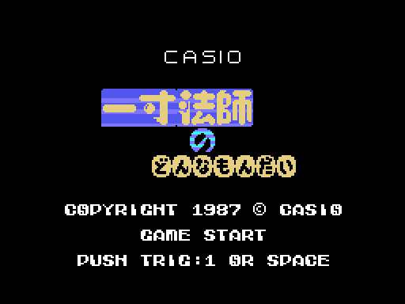
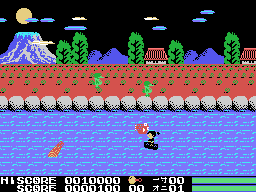

# The game

*Issun-boushi no Donnamondai* (一寸法師のどんなもんだい) tells, its own way, the tale of Issun-b&#333;shi, the
one-inch boy: he goes up the river in his bowl and, once ashore, fights the oni of each scene. There are five scenes;
the first four start on the river and the fifth is all on land. The scenes, in [The scenes](THE-SCENES.html).

Every GIF on this site is the ROM **running in openMSX** (a Japanese MSX1 with C-BIOS, at 60 frames per second): on
every frame the VRAM, the RAM and the VDP registers are logged, and `tools/vdp.py` paints them. The game ones are
played by a simple pilot (`tools/guiones/piloto.tcl`): it attacks every so often, jumps when a log reaches it from
the left, changes height and does not let the current carry it away.

## The CASIO intro and the title

Four CASIO come in from the sides and meet, with SOFTWARE below. The title shows the name (一寸法師 の どんなもんだい),
CASIO, GAME START, PUSH TRIG:1 OR SPACE and the copyright, and its tune plays. If it ends with nothing pressed, the
**demo** starts in a random scene of the first four; its controls are read from the start of the cartridge (see
[Curiosities](CURIOSITIES.html)).

## The controls

| | joystick | keyboard |
|---|---|---|
| change height on the river, walk on land | joystick 1 | the cursors |
| the weapon | button 1 | the space bar |
| jump | button 2 | GRAPH |
| pause | | STOP |

**The weapon** comes out in front of the hero 3 pixels per frame up to 12 and goes back (`arma`, 0x8E51); while it is
out, he does not move. On the river he always attacks to the left; on land, where he is facing. **The jump** is 48
steps of a table (0x8F4E): the bowl stays in the water and he goes up and down; on land he can jump to one side. On
land, **up** spends one of the things picked up and leaves him protected for a while (he blinks) and **down** makes
him crouch.

## The river

The current carries the bowl to the right, one pixel every 3 frames; against the right edge, every push is a hit.
Down the river, in the four lanes of the water and along the bank, come these (0xE380, the type at +4):

| | | points | |
|---|---|---:|---|
| 1 | the red fish | 50 | takes two blows of the weapon |
| 2 | the black and white fish | 100 | from scene 3 it heads for the hero's height |
| 3 | the green one on the bank | 300 | walks along the bank, two at most |
| 4 | the bird | 200 | from the left or from the right |
| 7 | the log | | the weapon does nothing to it and touching it without jumping is death |

Touching the others takes two eighths of the bar. The beaten ones sometimes leave something (`enemigo_tocado`,
0x949F: the bird and the green one more often): it bounces along the water and, if the hero gets it, gives 500 points
and one more (or three) to the counter under the picture on row 22.

## The scoreboard and the bars

At the bottom, HISCORE and SCORE with seven digits (the last one is a painted zero); the record starts at 10,000 and
at 10,000 points there is one more life, once. To the right, the reserve lives (0xE001) and the scene; and two bars of
eight squares, of eight eighths each: the top one is the hero's (0xE1B5), the bottom one that of the scene's oni
(0xE1B7).

## The falls and GAME OVER

With the bar empty or touching a log, the hero falls spinning (240 frames). With reserve lives, the scene starts
again from the beginning of the river; if he fell on land holding something picked up, or in the fifth scene, it goes
back to land. With no lives, the screen is wiped column by column and GAME OVER comes up.

