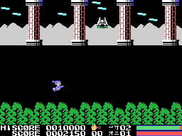
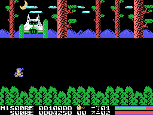
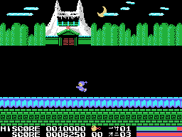
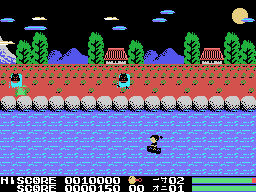
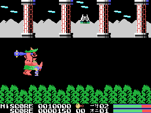
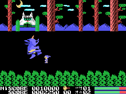
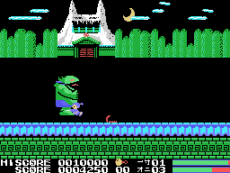
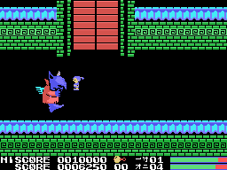
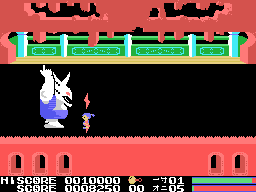
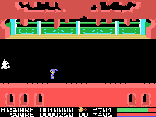

# The scenes

Five scenes (0xE003, from 0 to 4). Each of the first four has three parts (0xE051): **the river**, **reaching the
bank** and **land**, where the oni waits; the fifth is all on land. Beating the oni of the fifth brings the ending and
then another round from the first (0xE004).

The GIFs on this page, except the one of scene 1 (in [The game](THE-GAME.html)), come from a **forced** recording
(`tools/guiones/forzada.tcl`) to get to everything: CAPS on the title (endless lives), the hero's bar filled by hand
every 20 frames, the river cut short (after 900 frames, the map set at its end) and the oni's bar lowered to 4 after
900 frames of fighting. The same pilot plays.

## The river

Each river is a map of 192 x 14 tiles (0xE600, the list of drawings of each scene at 0x4460: 84, 52, 51 and 66) that
is painted mirrored, so that the scenery runs to the right while the bowl goes upstream: one column every 0x30 frames
(`rio_avanza`, 0x9241), 127 columns, a little over a minute and a half. Below, the water: tiles 0x90-0x93 and
0xA0-0xA1 change their drawing every 9 frames, in four steps (0xA0-0xA1 with other drawings in scenes 2 and 4).

What comes down the river appears every 48 to 111 frames in scene 1 and every 24 to 87 in scene 4
(`enemigos_salen`, 0x9AA2), in 4 slots (5 in scenes 3 and 4); from scene 3, faster.

## The bank

When the map ends, the bank (0x4A1E) shows up on the left, the hero goes to it on his own, the screen is wiped column
by column and the land scenery is painted (`tierra`, 0x91F6).

## The oni

On land there is no current and none of the river's enemies: there is the **oni** (0xE500), which is not a sprite but
a drawing made of screen tiles (5 drawings per scene: two it alternates standing still, two of one attack and one of
the other). It moves 8 pixels at a time, one column, and thinks every 16 runs of its routine in scene 1, one fewer in
each scene (`jefe_piensa`, 0x9C1A); the routine runs twice per frame (see [Curiosities](CURIOSITIES.html)), so in
scene 1 that is 8 frames. Depending on how far the hero is, it comes closer, moves away or attacks. From scene 3 its
attacks throw something that comes out of it down and to the right and, in scene 5, something that falls from above
towards the hero.

Touching its body is a hit and pushes the hero 16 pixels away; its attack, two. Each blow of the weapon takes one
eighth of the bottom bar: it takes 64. With little bar left, or at random, it backs off a few steps. Beaten, it
flickers, turns small and walks away to the left with tune 3; when it has walked 224 steps, the scene is over and it
gives 2,000 points.

## What is picked up

What the river's beaten enemies leave is counted under its picture, on row 23 (0xE054). On land, the joystick up
spends one: it appears beside him and the hero is protected (he blinks and hits do nothing to him) until a count
reaches 0xD0; it starts at the scene x 16, so it lasts less in each scene, and in the second round it starts at 0x50.

## The ending

With the oni of the fifth beaten (`escena_acabada`, 0x8344), the hero walks to the middle and a figure of 2 x 2
sprites comes in from the right, the girl of the tale by the look of it. Above her appear the same drawings as what
the beaten ones leave (0x78 and 0x7C), effect 1 sounds, the hero grows (four sprites instead of two) and どんなもんだい
("how about that!") comes up in big letters with tune 3. Then, another round.

