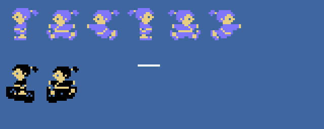
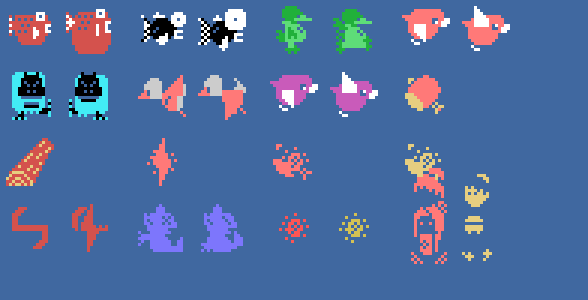
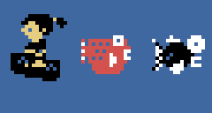

# The sprites

Everything on this page is **put together from the ROM tables** with `tools/hojas.py`. The drawings are the 0x800
bytes at 0xAA80 that `sprites_dibujos` puts at 0x3800; on land, `decorado_dibujos` puts on top of drawings 0x80-0xE7
their copy **facing the other way** (`sprites_vuelve`, 0x85C1: the first 0x340 bytes with each byte reversed and the
two halves swapped in the first 25 drawings; the 26th is only reversed). On the river there is no such copy, and
those numbers are the fish, the birds and the bowl. Each thing is made of 16-byte sprites from 0xE300 (the first 4,
its attributes): the bowl at 0xE310, Issun-boushi at 0xE320 and 0xE330, his weapon at 0xE340 and the enemies from
0xE380 (+4 the type, by the table at 0x947F; their second sprite is the next slot, with type 15). None of these
images is a screenshot.

**Checked against openMSX** on the recordings of this site:

- the sprite drawing table (VRAM 0x3800-0x3FFF) is **identical** to the one built here on 10,119 frames on land
  (with the copy facing the other way) and on 24,032 on the river (without it); on 1,061 more it is the other of the
  two, just reaching or leaving the bank; **6 unexplained**;
- Issun-boushi's two sprites match on 26,364 frames, and dead (falling while spinning) on 2,132; **1 unexplained**;
- the bowl on **15,967 frames, 0 different**;
- the enemies have a drawing and a colour of their type on 47,231 frames; 389 more are hit and 1,928 are the
  character of the end; **759 unexplained**.

## Issun-boushi and his bowl

Two sprites in the same place: the step (+0x0C) + the side (+0x0D, 0 or 0x80) in light blue (on the river, black)
and the drawing + 4 in light yellow (`prota_dibujo`, 0x8FAB). Top row, on land: facing right 0x00, 0x08 and 0x10,
and facing left the same + 0x80, from the copy turned the other way. Below, on the river, with his bowl
(`prota_sprites` 0x8F7E: 0x80 or 0x84 every 16 frames, black, 11 dots below and one to the left), and his weapon
(0x18, white):

## The enemies

Each one with the drawing and the drawing + 4 in its two sprites: the fish (`pez`: 0x88 in dark red and 0x98 in
black), the green one of the bank (`verde`: 0xC8, dark green; on odd scenes 0xA8, light red), the bird (`pajaro`:
0xD8 in cyan; on odd scenes 0xB8 in light red or 0xA8 in magenta), what is picked up (`cosa`: 0x78), the log
(`tronco`: 0x60), what falls from the sky (`cae_del_cielo`: 0x70), the boss's shots (`tiro_jefe`: 0x74;
`tiro_jefe2`: 0x68 and 0x6C) and the boss beaten, small (`jefe_se_va`: 0xF0-0xFC). Last, an enemy hit
(`enemigo_tocado`: 0x74 in red and dark yellow) and the character of the end (`escena_acabada`, 0x83A4: 2 × 2
sprites, 0x24, 0x28, 0x2C and 0x30). The boss itself is not a sprite: it is 8 × 8 tiles (`jefe_pon`):

On the river, with the bowl rocking, and the fish, at the game's pace:

