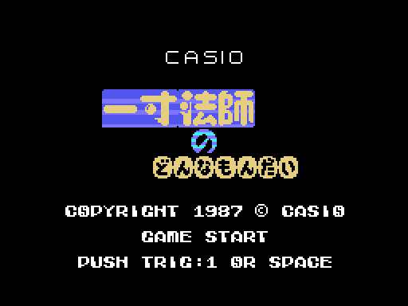
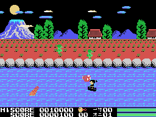

# La partida

*Issun-boushi no Donnamondai* (一寸法師のどんなもんだい) cuenta a su manera el cuento de Issun-b&#333;shi, el
ni&ntilde;o de una pulgada: sube el r&iacute;o en su cuenco y, al llegar a tierra, pelea con el oni de cada escena.
Son cinco escenas; las cuatro primeras empiezan en el r&iacute;o y la quinta es toda en tierra. Las escenas, en
[Las escenas](LAS-ESCENAS.html).

Cada GIF de esta web es la ROM **funcionando en openMSX** (un MSX1 japon&eacute;s con C-BIOS, a 60 cuadros por
segundo): en cada cuadro se apuntan la VRAM, la RAM y los registros del VDP, y `tools/vdp.py` los pinta. Los de la
partida los juega un piloto sencillo (`tools/guiones/piloto.tcl`): ataca cada poco, salta cuando un tronco le llega
por la izquierda, cambia de altura y no se deja llevar por la corriente.

## La presentaci&oacute;n y el t&iacute;tulo

Cuatro CASIO entran por los lados y se juntan, con SOFTWARE debajo. El t&iacute;tulo pone el nombre (一寸法師 の
どんなもんだい), CASIO, GAME START, PUSH TRIG:1 OR SPACE y el copyright, y suena su m&uacute;sica. Si acaba sin que
se pulse nada, empieza la **demostraci&oacute;n** en una escena al azar de las cuatro primeras; sus mandos se leen
del principio del cartucho (ver [Curiosidades](CURIOSIDADES.html)).

## Los mandos

| | mando | teclado |
|---|---|---|
| cambiar de altura en el r&iacute;o, andar en tierra | mando 1 | los cursores |
| el arma | bot&oacute;n 1 | la barra |
| saltar | bot&oacute;n 2 | GRAPH |
| pausa | | STOP |

**El arma** sale delante del protagonista 3 p&iacute;xeles por cuadro hasta 12 y vuelve (`arma`, 0x8E51); mientras
est&aacute; fuera, &eacute;l no se mueve. En el r&iacute;o siempre ataca hacia la izquierda; en tierra, hacia donde
mira. **El salto** son 48 pasos de una tabla (0x8F4E): el cuenco se queda en el agua y &eacute;l sube y baja; en
tierra puede saltar hacia un lado. En tierra, **arriba** gasta una de las cosas recogidas y lo deja protegido un rato
(parpadea) y **abajo** lo agacha.

## El r&iacute;o

La corriente lleva el cuenco hacia la derecha, un p&iacute;xel cada 3 cuadros; contra el borde derecho, cada empuje es
un golpe. Por el r&iacute;o bajan, en las cuatro calles del agua y por la orilla, estos (0xE380, el tipo en +4):

| | | puntos | |
|---|---|---:|---|
| 1 | el pez rojo | 50 | aguanta dos golpes del arma |
| 2 | el pez blanco y negro | 100 | desde la escena 3 va hacia la altura del protagonista |
| 3 | el verde de la orilla | 300 | anda por la orilla, dos como mucho |
| 4 | el p&aacute;jaro | 200 | por la izquierda o por la derecha |
| 7 | el tronco | | el arma no le hace nada y tocarlo sin saltar es la muerte |

Tocar a los dem&aacute;s quita dos octavos de la barra. Los vencidos a veces dejan algo (`enemigo_tocado`, 0x949F:
el verde y el p&aacute;jaro m&aacute;s a menudo): salta por el agua y, si el protagonista lo coge, da 500 puntos y uno
m&aacute;s (o tres) al contador de debajo del dibujo de la fila 22.

## El marcador y las barras

Abajo, HISCORE y SCORE con siete cifras (la &uacute;ltima es un cero pintado); el r&eacute;cord empieza en 10.000 y a
los 10.000 puntos hay una vida m&aacute;s, una vez. A la derecha, las vidas de reserva (0xE001) y la escena; y dos
barras de ocho casillas, de ocho octavos cada una: la de arriba es la del protagonista (0xE1B5), la de abajo la del
oni de la escena (0xE1B7).

## Las ca&iacute;das y GAME OVER

Con la barra vac&iacute;a o tocando un tronco, el protagonista cae dando vueltas (240 cuadros). Con vidas de reserva,
la escena empieza otra vez desde el principio del r&iacute;o; si cay&oacute; en tierra con algo recogido, o en
la quinta escena, vuelve a tierra.
Sin vidas, la pantalla se borra por columnas y sale GAME OVER.

