# Las escenas

Cinco escenas (0xE003, de 0 a 4). Cada una de las cuatro primeras tiene tres partes (0xE051): **el r&iacute;o**, la
**llegada a la orilla** y **tierra**, donde espera el oni; la quinta es toda en tierra. Al vencer al oni de la quinta
llega el final y despu&eacute;s otra vuelta desde la primera (0xE004).

Los GIF de esta p&aacute;gina, salvo el de la escena 1 (en [La partida](LA-PARTIDA.html)), son de una grabaci&oacute;n
**forzada** (`tools/guiones/forzada.tcl`) para llegar a todo: CAPS en el t&iacute;tulo (vidas sin fin), la barra del
protagonista llenada a mano cada 20 cuadros, el r&iacute;o acortado (a los 900 cuadros, el mapa puesto en su final) y
la barra del oni bajada a 4 a los 900 cuadros de pelea. Juega el mismo piloto.

## Los mapas

Las cinco escenas, cada una en una fila: a la izquierda el río entero, a la derecha la tierra donde espera el oni; la
quinta no tiene río. Están **pintadas ejecutando la ROM** (`tools/mapas.py`), sobre las casillas de un cuadro grabado
de cada escena:

- **el río**: `rio_decorado` (0x90F1) monta su mapa en la RAM, 14 filas de 192 casillas (las columnas 0-0x3F se
  copian en las 0x40-0x7F: el río se repite), y `rio_pinta` enseña 32 columnas desde el avance (0xE190, de 0 a 0x7F)
  **con cada fila al revés**; aquí van las 159 columnas que se llegan a ver, en el orden de la pantalla, con el
  principio del río a la derecha y el agua debajo;
- **la tierra**: `decorado_dibujos`, `tierra_decorado` y `decorado_pinta` (0x920F-0x9218), como al llegar a la orilla.

Cotejo con las grabaciones: en el río, el tramo de 32 columnas que dice el avance sale **igual** a la tabla de nombres
grabada en 3.553 de 3.905 cuadros (mediana 0). En tierra, unos 150 cuadros por escena salen iguales y la mediana es de
unas 22 casillas distintas de 704: lo que se pinta encima en esas filas; esas diferencias no se han mirado una a una.

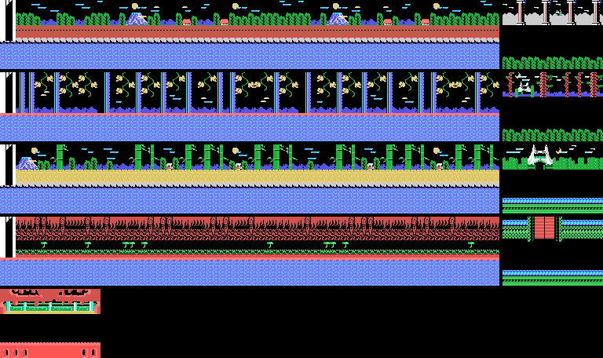

## El r&iacute;o

Cada r&iacute;o es un mapa de 192 x 14 casillas (0xE600, la lista de dibujos de cada escena en 0x4460: 84, 52, 51 y
66) que se pinta al rev&eacute;s, de modo que el decorado corre hacia la derecha mientras el cuenco remonta: una columna
cada 0x30 cuadros (`rio_avanza`, 0x9241), 127 columnas, algo m&aacute;s de minuto y medio. Debajo, el agua: las
casillas 0x90-0x93 y 0xA0-0xA1 cambian de dibujo cada 9 cuadros, en cuatro pasos (las 0xA0-0xA1, con otros
dibujos en las escenas 2 y 4).

Lo que baja por el r&iacute;o sale cada 48 a 111 cuadros en la escena 1 y cada 24 a 87 en la 4 (`enemigos_salen`,
0x9AA2), en 4 huecos (5 en las escenas 3 y 4); desde la 3, m&aacute;s r&aacute;pido.

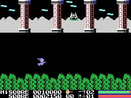

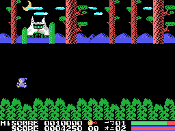

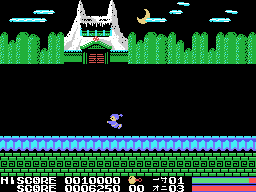

## La orilla

Acabado el mapa, la orilla (0x4A1E) aparece a la izquierda, el protagonista va solo hasta ella, la pantalla se cierra
por columnas y se pinta el decorado de tierra (`tierra`, 0x91F6).

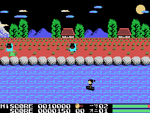

## El oni

En tierra no hay corriente ni enemigos del r&iacute;o: est&aacute; el **oni** (0xE500), que no es un sprite sino un
dibujo de casillas de la pantalla (5 dibujos por escena: dos que alterna parado, dos de un ataque y uno del otro). Se mueve
de 8 en 8 p&iacute;xeles, una columna, y piensa cada 16 pasadas de su rutina en la escena 1, una menos en cada
escena (`jefe_piensa`, 0x9C1A); la rutina corre dos veces por cuadro (ver [Curiosidades](CURIOSIDADES.html)),
as&iacute; que en la escena 1 son 8 cuadros. Seg&uacute;n lo lejos que est&eacute; el protagonista se acerca, se
aparta o ataca. Desde la escena 3 sus ataques tiran algo que sale
de &eacute;l hacia abajo y a la derecha y, en la 5, algo que cae desde arriba hacia el protagonista.

Tocar su cuerpo es un golpe y lo aparta 16 p&iacute;xeles; su ataque, dos. Cada golpe del arma le quita un octavo de
la barra de abajo: hacen falta 64. Con poca barra, o al azar, se retira unos pasos. Vencido, parpadea, se hace
peque&ntilde;o y se va andando hacia la izquierda con la m&uacute;sica 3; cuando ha andado 224 pasos, la escena se acaba
y da 2.000 puntos.

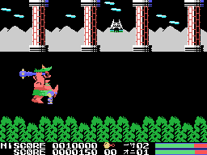

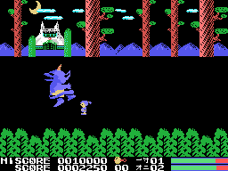

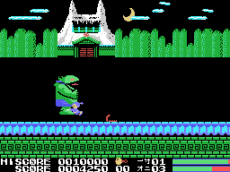

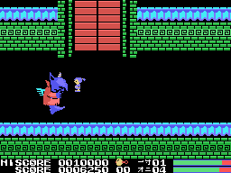

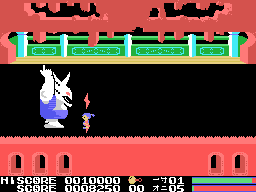

## Lo recogido

Lo que dejan los vencidos del r&iacute;o se cuenta debajo de su dibujo, en la fila 23 (0xE054). En tierra, la palanca
arriba gasta uno: sale a su lado y el protagonista queda protegido (parpadea y los golpes no le hacen nada) hasta que una
cuenta llega a 0xD0; empieza en la escena x 16, as&iacute; que dura menos en cada escena, y en la segunda vuelta
empieza en 0x50.

## El final

Vencido el oni de la quinta (`escena_acabada`, 0x8344), el protagonista anda hasta el centro y llega por la derecha una
figura de 2 x 2 sprites, la muchacha del cuento por el dibujo. Encima de ella aparecen los mismos dibujos de lo que dejan
los vencidos (0x78 y 0x7C), suena el efecto 1, el protagonista se hace grande (cuatro sprites en vez de dos) y sale
どんなもんだい ("&iquest;qu&eacute; te parece?") en letras grandes con la m&uacute;sica 3. Despu&eacute;s, otra vuelta.

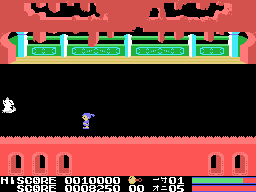
