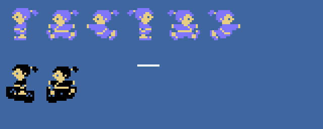
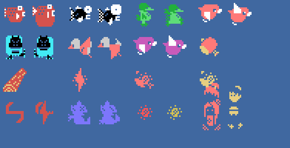
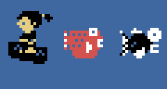

# Los sprites

Todo lo de esta página está **montado desde las tablas de la ROM** con `tools/hojas.py`. Los dibujos son los 0x800
bytes de 0xAA80 que `sprites_dibujos` pone en 0x3800; en tierra, `decorado_dibujos` pone encima de los dibujos
0x80-0xE7 su copia **mirando al otro lado** (`sprites_vuelve`, 0x85C1: los 0x340 primeros bytes con cada byte del revés
y las dos mitades cambiadas en los 25 primeros dibujos; el 26, solo del revés). En el río no hay esa copia, y esos
números son los peces, los pájaros y el cuenco. Cada cosa son sprites de 16 bytes desde 0xE300 (los 4 primeros, sus
atributos): el cuenco en 0xE310, Issun-boushi en 0xE320 y 0xE330, su arma en 0xE340 y los enemigos desde 0xE380 (+4 el
tipo, por la tabla de 0x947F; su segundo sprite es el hueco siguiente, con el tipo 15). Ninguna de estas imágenes es
una captura.

**Cotejado con openMSX** en las grabaciones de esta web:

- la tabla de dibujos de los sprites (VRAM 0x3800-0x3FFF) es **idéntica** a la montada aquí en 10.119 cuadros en
  tierra (con la copia vuelta) y en 24.032 en el río (sin ella); en otros 1.061 es la otra de las dos, justo al llegar
  a la orilla o al dejarla; **6 sin explicar**;
- los dos sprites de Issun-boushi casan en 26.364 cuadros, y muerto (cayendo dando vueltas) en 2.132; **1 sin
  explicar**;
- el cuenco en **15.967 cuadros, 0 distintos**;
- los enemigos llevan un dibujo y un color de su tipo en 47.231 cuadros; otros 389 están tocados y 1.928 son el
  personaje del final; **759 sin explicar**.

## Issun-boushi y su cuenco

Dos sprites en el mismo sitio: el paso (+0x0C) + el lado (+0x0D, 0 u 0x80) en azul claro (en el río, negro) y el
dibujo + 4 en amarillo claro (`prota_dibujo`, 0x8FAB). Arriba, en tierra: mirando a la derecha 0x00, 0x08 y 0x10, y a
la izquierda los mismos + 0x80, de la copia vuelta. Abajo, en el río, con su cuenco (`prota_sprites` 0x8F7E: 0x80 o
0x84 cada 16 cuadros, negro, 11 puntos por debajo y uno a la izquierda), y su arma (0x18, blanca):

## Los enemigos

Cada uno con el dibujo y el dibujo + 4 en sus dos sprites: los peces (`pez`: 0x88 en rojo oscuro y 0x98 en negro), el
verde de la orilla (`verde`: 0xC8, verde oscuro; en las escenas impares 0xA8, rojo claro), el pájaro (`pajaro`: 0xD8
en cian; en las escenas impares 0xB8 en rojo claro o 0xA8 en magenta), lo que se recoge (`cosa`: 0x78), el tronco
(`tronco`: 0x60), lo que cae del cielo (`cae_del_cielo`: 0x70), los tiros del jefe (`tiro_jefe`: 0x74; `tiro_jefe2`:
0x68 y 0x6C) y el jefe vencido, en pequeño (`jefe_se_va`: 0xF0-0xFC). Al final, un enemigo tocado (`enemigo_tocado`:
0x74 en rojo y amarillo oscuro) y el personaje del final (`escena_acabada`, 0x83A4: 2 × 2 sprites, 0x24, 0x28, 0x2C y
0x30). El jefe en sí no es un sprite: son 8 × 8 casillas (`jefe_pon`):

En el río, con el cuenco meciéndose, y los peces, al ritmo del juego:

